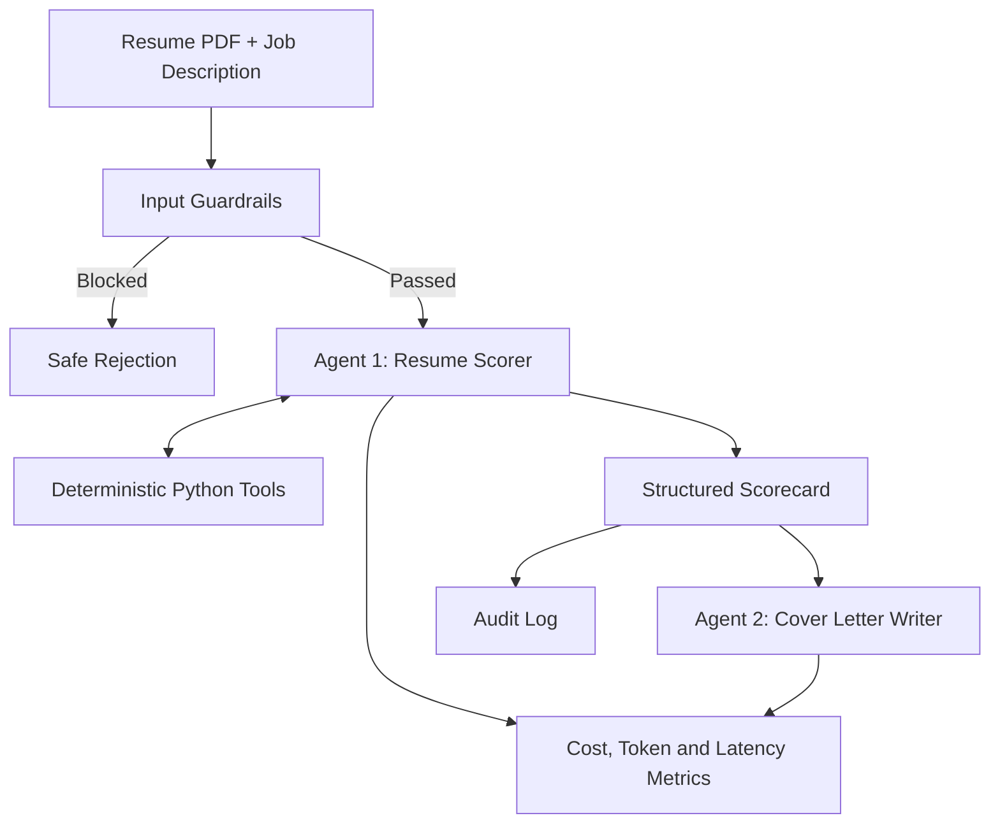

# JD Matcher

An explainable, multi-agent AI application that evaluates a resume against a job description, identifies evidence-backed gaps, and generates a tailored cover letter.

JD Matcher is built to make the agent workflow visible: the model chooses tools, Python executes them, results are returned to the model, and the complete interaction is exposed through an audit log. The project focuses on the engineering concerns that matter beyond a demo - guardrails, structured agent handoffs, observability, configuration, and reliable output parsing.

## What It Does

Upload a resume in PDF format and paste a job description. JD Matcher returns:

- A role-specific fit score from 0 to 10
- Resume strengths mapped to the job requirements
- Actionable areas for improvement
- Important JD keywords missing from the resume
- A tailored three-paragraph cover letter
- A complete agent conversation and tool-call audit trail
- Token usage, estimated cost, latency, and wall-time metrics

## Why This Project

A useful AI solution needs more than a prompt and a chat box. It needs controlled tool access, clear boundaries between agents, protection against untrusted input, predictable outputs, and enough telemetry to understand what happened.

JD Matcher explores those concerns with a practical workflow that is easy to inspect and extend. The agent orchestration is implemented directly with the OpenAI-compatible API instead of an agent framework, making the loop, state, tool execution, and handoffs explicit.

## Architecture



### Agent 1 - Resume Scorer

The scoring agent runs an explicit tool-calling loop. It must use deterministic Python tools before producing a scorecard:

- `count_keywords`: checks the resume for technical skills extracted from the JD
- `check_years_of_experience`: validates experience using explicit claims and employment date ranges

The agent returns a structured JSON scorecard containing the fit score, strengths, improvement areas, and missing keywords.

### Agent 2 - Cover Letter Writer

The writing agent receives only the structured scorecard and the original job description. It never receives the raw resume. This creates a narrow, auditable handoff between agents and reduces unnecessary data exposure.

## Reliability and Safety

- Prompt-injection detection for both resume and JD content
- Structural validation to reject empty or invalid job descriptions
- Clear separation between trusted system instructions and untrusted uploaded text
- Three-stage JSON recovery: direct parse, extraction cleanup, and model-assisted repair
- Task-specific temperature controls for scoring, writing, and JSON repair
- Secrets loaded from `.env`, separate from non-secret YAML configuration
- Complete per-run audit trail of model messages and tool calls

> The guardrails in this project are defense-in-depth examples, not a complete security boundary. Production systems should combine them with stronger policy enforcement, data-loss prevention, access controls, evaluation suites, and continuous monitoring.

## Observability

Each run records:

- LLM calls and agent turns
- Prompt, completion, and total tokens
- Estimated model cost
- LLM and tool latency
- Total wall-clock time
- Tool invocation history

The Streamlit sidebar displays both per-agent metrics and cumulative session totals.

## Tech Stack

- Python
- Streamlit
- OpenAI-compatible tool-calling API
- Groq
- `openai/gpt-oss-120b`
- PyPDF
- PyYAML
- python-dotenv

## Getting Started

### 1. Clone the repository

```bash
git clone https://github.com/kashishsingh98/jd_matcher.git
cd jd_matcher
```

### 2. Create and activate a virtual environment

```bash
python3 -m venv .venv
source .venv/bin/activate
```

On Windows:

```powershell
.venv\Scripts\activate
```

### 3. Install dependencies

```bash
pip install -r requirements.txt
```

### 4. Configure the API key

Create a `.env` file in the project root:

```env
GROQ_API_KEY=your_groq_api_key
```

Never commit the `.env` file or expose your API key.

### 5. Run the application

```bash
streamlit run main.py
```

## Configuration

Non-secret settings live in `config/config.yaml`, including:

- Model name and API base URL
- Temperature by task
- Pricing used for cost estimation
- UI settings and display limits

This keeps model behavior configurable without mixing application settings with secrets.

## Project Structure

```text
jd_matcher/
├── config/
│   └── config.yaml
├── src/
│   └── jd-matcher/
│       ├── agent.py
│       ├── cover_letter_agent.py
│       ├── guardrails.py
│       ├── metrics.py
│       ├── prompts.py
│       ├── tools.py
│       └── ui.py
├── main.py
└── requirements.txt
```

## Design Decisions

| Decision | Why |
|---|---|
| Direct agent loop | Makes tool selection, state, and exit conditions transparent |
| Deterministic Python tools | Grounds important checks in inspectable code |
| Structured agent handoff | Limits context sharing and creates a clean contract between agents |
| Low scoring temperature | Improves consistency for an evaluative task |
| Separate writing temperature | Allows more natural cover-letter language |
| Audit log and metrics | Makes behavior, cost, and latency easier to debug |
| YAML configuration | Separates operational settings from implementation and secrets |

## Current Limitations

- Supports text-based PDF resumes; scanned PDFs require OCR
- Keyword counting is currently substring-based
- Experience calculation does not yet merge overlapping employment periods
- Fit scores are model-generated and should support, not replace, human judgment
- Guardrails use pattern-based detection and are not exhaustive
- Pricing estimates depend on the values configured in `config/config.yaml`

## Roadmap

- Batch scoring and candidate ranking
- OCR support for scanned resumes
- Schema validation with Pydantic
- Evaluation dataset for score consistency and grounding
- Critic/verifier agent for score review
- Human-in-the-loop screening decisions
- Persistent traces and production-grade monitoring
- Automated tests and CI

## FDE Perspective

This project demonstrates the workflow behind forward-deployed engineering: start from a real user problem, translate it into an end-to-end product, integrate model and deterministic components, add operational controls, expose the system's decisions, and leave clear extension points for customer-specific requirements.

## Disclaimer

JD Matcher is an educational project. Its output should not be used as the sole basis for employment decisions. AI-generated scores may be incomplete or biased and should always be reviewed by a human.

## Author

**Kashish Singh**

- GitHub: [kashishsingh98](https://github.com/kashishsingh98)
- Project: [JD Matcher](https://github.com/kashishsingh98/jd_matcher)
